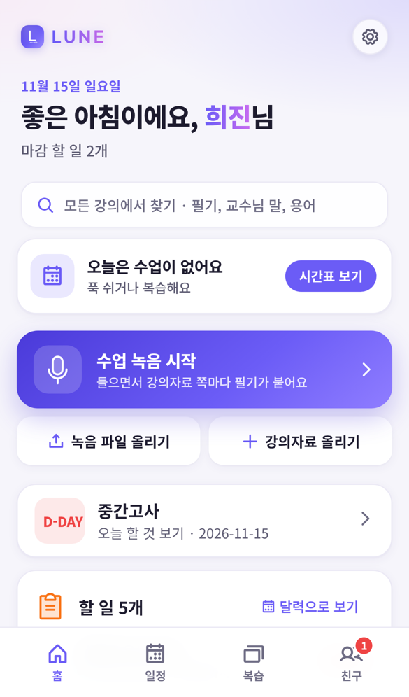
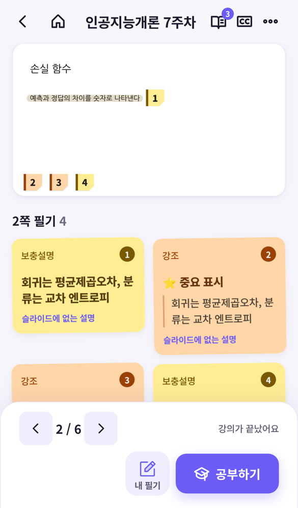
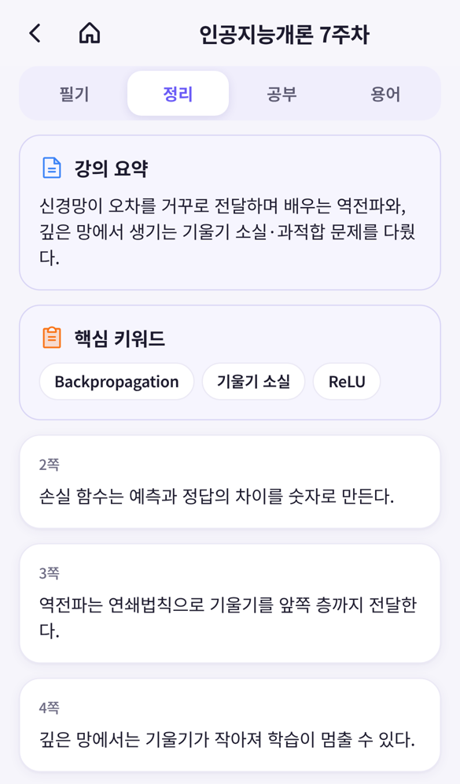
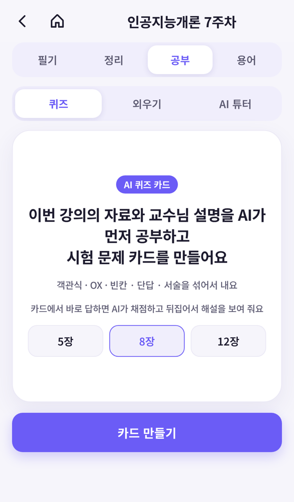
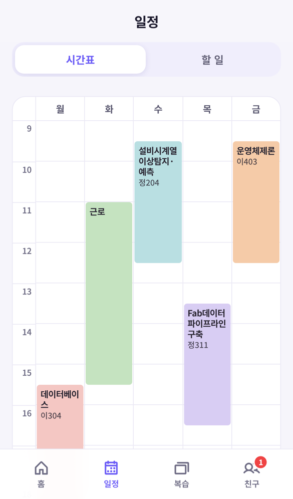
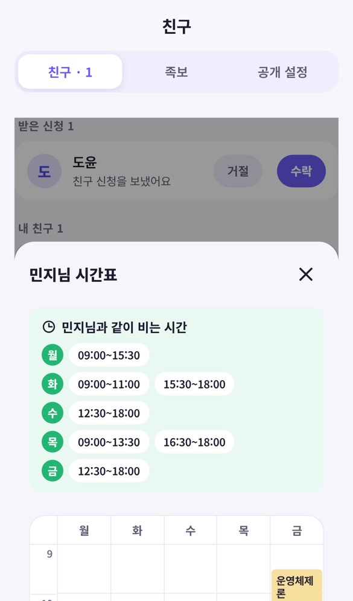

# LUNE — 수업을 대신 들어 주는 AI 강의 노트

**Listen. Learn. Remember.**

강의자료(PDF·PPT·한글)에 수업 녹음을 붙이면, AI가 교수님 설명을 받아써서 **지금 설명 중인 슬라이드 쪽에 필기를 달아 주고**, 퀴즈·복습 카드·친구와 합친 족보까지 만들어 주는 대학생용 강의 노트 앱입니다.

| 홈 | 강의 화면 (쪽별 AI 필기) | 강의 정리 |
| :---: | :---: | :---: |
|  |  |  |
| **AI 퀴즈** | **캡처로 만든 시간표** | **친구와 같이 비는 시간** |
|  |  |  |

## 왜 만들었나

대학 강의는 슬라이드를 빠르게 넘기며 말로 설명하는 부분이 많아, 받아 적으면 설명을 놓치고 들으면 필기를 놓칩니다. 녹음해 두어도 75분짜리를 다시 듣기는 어렵고, 시험 기간에는 "시험에 나온다"고 한 부분을 찾기 힘듭니다. LUNE은 들은 내용이 슬라이드 쪽마다 필기로 남고, 그대로 복습과 시험 준비로 이어지게 합니다.

## 주요 기능

- **실시간 쪽별 필기**: 말을 9~20초씩 받아쓰고, 지금 몇 쪽을 설명 중인지 추정해 그 쪽에 AI 필기(보충설명·예시·강조·시험·공지·AI 팁·질문)를 붙입니다. '이 쪽 고정'으로 직접 정할 수도 있습니다.
- **녹음 파일 정리**: 이미 녹음한 파일도 같은 방식으로 정리합니다. 영어 강의도 지원합니다.
- **수업 중 표시와 다시 듣기**: '모르겠어요'·'중요'를 누르면 그 시각이 남고, 필기를 누르면 그 순간의 녹음을 다시 듣습니다(배속·침묵 건너뛰기).
- **정리와 복습**: 강의 요약, 쪽별 정리, 용어 사전, 객관식·OX·빈칸·단답·서술 AI 퀴즈와 채점, 잊기 곡선 복습 카드, 약점 노트.
- **AI 튜터**: 이 강의·이 과목·학기 전체 중 범위를 골라 질문하면 근거 강의와 쪽을 함께 알려 줍니다.
- **과제·마감 자동 정리**: 교수님 말에서 과제와 마감을 찾아 할 일·달력·알림으로 만듭니다.
- **시간표 캡처 인식**: 에브리타임·학교 포털 시간표 캡처 한 장으로 시간표를 만듭니다.
- **친구와 족보 합치기**: 같은 자료로 들은 친구들의 시험·강조 필기를 합칩니다. 기본은 비공개이고, 공유할 과목만 고릅니다.
- **녹음 지키기**: 기기에도 녹음을 저장해 인터넷이 끊겨도 빠지지 않고, 앱이 꺼지면 이어서 녹음합니다.

## 구성

```
안드로이드 앱 (Kotlin)  ─┐
휴대폰·PC 웹 (React)   ─┼─ Tailscale Funnel ─▶ 서버 (FastAPI + SQLite, 오라클 무료 서버)
                         │                        ├ 실시간 녹음: WebSocket → 받아쓰기 → 쪽 추정 → 필기
                         │                        ├ AI: Groq 무료 (Whisper, gpt-oss-120b) · 한도가 차면 다른 모델 → 서버 안 Whisper
                         │                        └ 하루 한 번 자동 백업 · 1시간마다 자동 업데이트
```

| 폴더 | 내용 |
| --- | --- |
| `server/` | Python FastAPI 서버, 테스트(`server/tests`) |
| `web/` | React + TypeScript 화면 (Vite) |
| `android/` | Kotlin 안드로이드 앱 (화면은 웹을 띄우고, 녹음·알림은 앱이 직접) |
| `deploy/` | 오라클 무료 서버 설치 스크립트 |
| `docs/` | 개발 메모, 화면 사진 |

운영 비용은 **0원**입니다. 오라클 Always Free 서버, Groq 무료 API, Tailscale·허깅페이스 무료 서비스만 씁니다.

## 직접 실행해 보기

```bash
# 서버 (키 없이 가짜 AI 응답으로)
cd server && python3 -m venv .venv && .venv/bin/pip install -r requirements.txt
LLM_MODE=fake STT_MODE=fake .venv/bin/uvicorn app.main:app --port 8000

# 화면
cd web && npm install && npm run dev
```

Groq 키를 넣고 실제 AI로 쓰는 방법과 자세한 동작은 [`docs/DEV-NOTES.md`](docs/DEV-NOTES.md)에 있습니다.

## 저작권

© 2026 김희진. All rights reserved. 읽어 보는 것은 자유지만, 허락 없이 복사·수정·배포·상업적 이용은 할 수 없습니다. [`LICENSE`](LICENSE)
